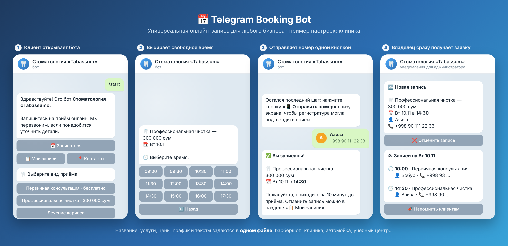
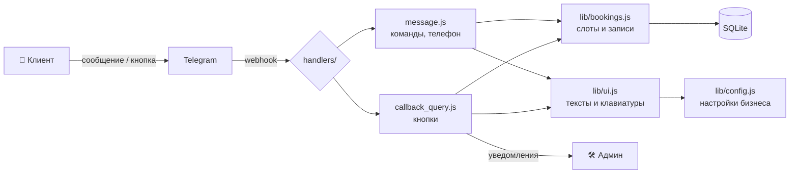

<div align="center">

# 📅 Telegram Booking Bot

**Универсальный бот онлайн-записи для любого бизнеса: от барбершопа до клиники**

Клиент записывается в 4 нажатия. Владелец сразу получает уведомление.
Работает на [Telegram Serverless](https://core.telegram.org/bots/serverless) **или** на любом сервере с Node.js / Docker: код один и тот же.

[](https://github.com/noname-programmer/telegram-booking-bot/actions/workflows/test.yml)


**[▶️ Открыть демо: @schedule_mkapp](https://t.me/schedule_mkapp)**



</div>

---

## 💡 Для какого бизнеса

Бот не привязан к конкретной сфере. Название, услуги, цены, график и все тексты задаются в **одном файле**. В папке [`examples/`](examples) лежат готовые настройки:

| | Бизнес | Пример настроек |
|---|---|---|
| ✂️ | Барбершоп, салон красоты | [`barbershop.js`](examples/barbershop.js) |
| 🦷 | Стоматология, клиника | [`clinic.js`](examples/clinic.js) |
| 🚗 | Автомойка, автосервис | [`carwash.js`](examples/carwash.js) |
| 📚 | Учебный центр, репетитор | [`tutor.js`](examples/tutor.js) |

Подходит и для фотостудий, массажа, юристов, психологов, коворкингов: везде, где клиент выбирает время.

## ✨ Возможности

<table>
<tr>
<td width="50%" valign="top">

### 👤 Клиент
- 📅 Запись: услуга → день → время → телефон
- 🕐 Показываются только свободные слоты
- 📱 Номер одной кнопкой (или вручную текстом)
- 📋 «Мои записи»: просмотр и отмена
- 📍 Адрес, телефон и карта

</td>
<td width="50%" valign="top">

### 🛠 Владелец (админка в боте)
- 🔔 Уведомления о новых записях и отменах
- 🗓 Записи на любой день с телефонами
- ❌ Отмена с автоматическим сообщением клиенту
- 📣 Напоминания всем клиентам дня одной кнопкой
- 👥 Несколько администраторов

</td>
</tr>
</table>

### 🔒 Надёжность
- **Двойная запись невозможна.** Проверка перед сохранением и уникальный индекс в базе данных на случай одновременных нажатий.
- **Защита от подделки кнопок.** Клиент не может отменить чужую запись, открыть админку или записаться на прошедшую дату.
- **Автотесты.** 28 сценариев на каждой из 5 конфигураций и сквозная проверка запуска без Serverless при каждом коммите (GitHub Actions).

## ⚙️ Настройка за 2 минуты

Всё меняется в [`tgcloud/lib/config.js`](tgcloud/lib/config.js):

```js
export const BUSINESS = { name: 'Стоматология «Tabassum»', address: '…', phone: '…' };

export const SERVICES = [
  { id: 'consult', title: 'Первичная консультация', price: 0 },      // → «бесплатно»
  { id: 'clean',   title: 'Профессиональная чистка', price: 300000 }, // → «300 000 сум»
  { id: 'treat',   title: 'Лечение кариеса',         price: null },   // цена не показывается
];

export const SCHEDULE = { open: '09:00', close: '18:00', slotMinutes: 30, daysOff: [0] };
```

Затем выполни `npx tgcloud push`, и бот обновлён.

## 🚀 Запуск: два способа

Код бота (`tgcloud/`) один. Меняется только то, **где** он работает:

| | ☁️ Telegram Serverless | 🖥 Свой сервер (Node.js / Docker) |
|---|---|---|
| Хостинг | бесплатно, у Telegram | VPS от ~$3–5/мес или любой компьютер 24/7 |
| Доступность | пока не у всех ботов | везде |
| Как получает сообщения | webhook (платформа) | long polling (`standalone/bot.js`) |
| База данных | встроенная SQLite | файл SQLite `data/bot.db` |

Подробно, по шагам: **[ЗАПУСК.md](ЗАПУСК.md)**.

### ☁️ Вариант А: Telegram Serverless

```bash
npm install
npx tgcloud login      # токен: @BotFather → бот → Serverless → CLI Access
npx tgcloud push       # загрузить код
npx tgcloud migrate    # создать таблицы
```

### 🖥 Вариант Б: свой сервер или компьютер

```bash
cd standalone
cp .env.example .env   # впиши BOT_TOKEN от @BotFather
npm install
npm start
```

или через Docker:

```bash
cp standalone/.env.example standalone/.env   # впиши BOT_TOKEN
docker compose up -d --build
```

`standalone/sdk.js` подменяет платформенный `sdk`: `db` работает через настоящую SQLite и Drizzle ORM, `api` — через Telegram Bot API. Обработчики бота при этом не меняются ни на строчку.

## 🏗 Архитектура



```
tgcloud/
├─ schema.js                 # таблицы: bookings, drafts
├─ handlers/
│  ├─ message.js             # команды, телефон клиента
│  └─ callback_query.js      # нажатия на кнопки
└─ lib/
   ├─ config.js              # ⚙️ настройки бизнеса
   ├─ bookings.js            # слоты, записи, черновики
   ├─ ui.js                  # тексты и клавиатуры
   └─ time.js                # даты в часовом поясе бизнеса
examples/                    # готовые настройки для разных видов бизнеса
standalone/                  # запуск без Serverless: Node.js + SQLite + long polling
├─ bot.js                    # получает обновления и вызывает те же handlers/
├─ sdk.js                    # замена платформенного sdk (SQLite + Bot API)
└─ schema.sql                # таблицы (тесты проверяют, что совпадают с schema.js)
test/                        # тесты сценариев с эмуляцией платформы
Dockerfile, docker-compose.yml
```

## 🧪 Тесты

Три уровня проверок, все запускаются в GitHub Actions при каждом коммите:

| Проверка | Что делает | Команда |
|---|---|---|
| Сценарии | 28 сценариев × 5 конфигураций; `sdk` заменён на SQLite и поддельный Bot API | `cd test && npm test` |
| Standalone | запускает настоящий `bot.js` против поддельного сервера Telegram и проходит запись целиком | `cd standalone && npm run smoke` |
| Docker | собирает образ | `docker build .` |

```
━━━ examples/clinic.js ━━━
Конфигурация: Стоматология «Tabassum» · услуг: 3 · слотов в день: 18
✅ Контакт → запись создана, клиенту подтверждение, админу уведомление
✅ Гонка: время заняли, пока клиент отправлял номер
✅ Чужую запись отменить нельзя
…
🎉 Все 5 конфигурации прошли проверку
```

## 🤖 Команды

| Команда | Что делает |
|---|---|
| `/start` | Главное меню |
| `/myid` | Показать свой Telegram ID (для настройки админов) |
| `/admin` | Админка (только для `ADMIN_IDS`) |

## 🗺 Планы

- [ ] Несколько мастеров или специалистов с отдельным расписанием
- [ ] Услуги разной длительности
- [ ] Автонапоминания за 2 часа (когда платформа добавит запуск по расписанию)
- [ ] Предоплата через Telegram Payments
- [ ] Интерфейс на узбекском языке
- [ ] Mini App с календарём

## 📄 Лицензия

[MIT](LICENSE)
