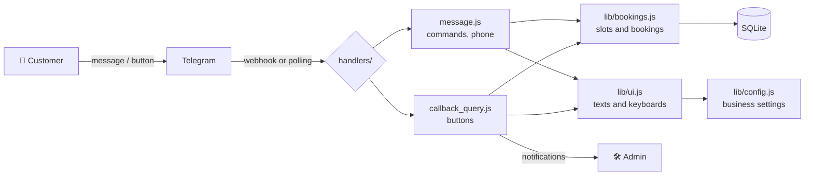

<div align="center">

**English** · [Русский](README.ru.md)

# 📅 Telegram Booking Bot

**A universal appointment-booking bot for any business, from barbershops to clinics**

Customers book in 4 taps. The owner is notified instantly.
Runs on [Telegram Serverless](https://core.telegram.org/bots/serverless) **or** on any server with Node.js or Docker, from the same code.

[](https://github.com/noname-programmer/telegram-booking-bot/actions/workflows/test.yml)


**[▶️ Try the live demo: @schedule_mkapp](https://t.me/schedule_mkapp)**


<sub>The bot's interface is in Russian, its customers' main language. All texts live in one config file.</sub>

</div>

---

## 💡 Who it is for

The bot isn't tied to one industry. The business name, services, prices, working hours and all customer-facing texts are set in **a single file**. Ready-made configs are in [`examples/`](examples):

| | Business | Example config |
|---|---|---|
| ✂️ | Barbershop, beauty salon | [`barbershop.js`](examples/barbershop.js) |
| 🦷 | Dental clinic, private clinic | [`clinic.js`](examples/clinic.js) |
| 🚗 | Car wash, car service | [`carwash.js`](examples/carwash.js) |
| 📚 | Language school, tutor | [`tutor.js`](examples/tutor.js) |

It also fits photo studios, massage therapists, lawyers, psychologists and coworking spaces: any business where a customer picks a time.

## ✨ Features

<table>
<tr>
<td width="50%" valign="top">

### 👤 Customer
- 📅 Booking flow: service → day → time → phone number
- 🕐 Only free slots are shown
- 📱 Share phone number with one tap (or type it)
- 📋 "My bookings": view and cancel
- 📍 Address, phone and map link

</td>
<td width="50%" valign="top">

### 🛠 Owner (admin panel inside the bot)
- 🔔 Notifications about new bookings and cancellations
- 🗓 Bookings for any day, with phone numbers
- ❌ Cancel a booking, and the customer is notified automatically
- 📣 Send reminders to all of a day's customers in one tap
- 👥 Multiple admins

</td>
</tr>
</table>

### 🔒 Reliability
- **No double bookings.** The slot is checked before saving, and a partial unique index in the database catches simultaneous taps.
- **Tamper-proof buttons.** A customer can't cancel someone else's booking, open the admin panel, or book a past date by forging button data.
- **Automated checks.** On every commit, GitHub Actions runs a linter, 28 scenarios on each of 5 configs, an end-to-end run without Serverless, and a Docker build.

## ⚙️ Configure in 2 minutes

Everything is in [`tgcloud/lib/config.js`](tgcloud/lib/config.js):

```js
export const BUSINESS = { name: 'Стоматология «Tabassum»', address: '…', phone: '…' };

export const SERVICES = [
  { id: 'consult', title: 'Первичная консультация', price: 0 },      // → "free"
  { id: 'clean',   title: 'Профессиональная чистка', price: 300000 }, // → "300 000 сум"
  { id: 'treat',   title: 'Лечение кариеса',         price: null },   // price hidden
];

export const SCHEDULE = { open: '09:00', close: '18:00', slotMinutes: 30, daysOff: [0] };
```

Then run `npx tgcloud push`, and the bot is updated.

## 🚀 Two ways to run

There is one codebase (`tgcloud/`). Only **where** it runs changes:

| | ☁️ Telegram Serverless | 🖥 Your own server (Node.js / Docker) |
|---|---|---|
| Hosting | free, hosted by Telegram | a VPS from ~$3–5/month, or any always-on computer |
| Availability | not yet available to all users | everyone |
| Receives updates via | webhook (managed by the platform) | long polling (`standalone/bot.js`) |
| Database | built-in SQLite | SQLite file `data/bot.db` |

A step-by-step guide (in Russian): **[ЗАПУСК.md](ЗАПУСК.md)**.

### ☁️ Option A: Telegram Serverless

```bash
npm install
npx tgcloud login      # token: @BotFather → your bot → Serverless → CLI Access
npx tgcloud push       # upload the code
npx tgcloud migrate    # create the tables
```

### 🖥 Option B: your own server or computer

```bash
cd standalone
cp .env.example .env   # put BOT_TOKEN from @BotFather here
npm install
npm start
```

or with Docker:

```bash
cp standalone/.env.example standalone/.env   # put BOT_TOKEN here
docker compose up -d --build
```

`standalone/sdk.js` replaces the platform `sdk`: `db` runs on a real SQLite database through Drizzle ORM, and `api` calls the Telegram Bot API. The bot's handlers don't change at all.

## 🏗 Architecture



```
tgcloud/
├─ schema.js                 # tables: bookings, drafts
├─ handlers/
│  ├─ message.js             # commands, customer's phone number
│  └─ callback_query.js      # button presses
└─ lib/
   ├─ config.js              # ⚙️ business settings
   ├─ bookings.js            # slots, bookings, drafts
   ├─ ui.js                  # texts and keyboards
   └─ time.js                # dates in the business's time zone
examples/                    # ready configs for different businesses
standalone/                  # running without Serverless: Node.js + SQLite + long polling
├─ bot.js                    # fetches updates and calls the same handlers/
├─ sdk.js                    # replacement for the platform sdk (SQLite + Bot API)
└─ schema.sql                # tables (tests check they match schema.js)
test/                        # scenario tests with an emulated platform
Dockerfile, docker-compose.yml
```

## 🧪 Quality checks

Four checks run in GitHub Actions on every commit:

| Check | What it does | Command |
|---|---|---|
| Lint | ESLint looks for bugs and suspicious code | `npm run lint` |
| Scenarios | 28 scenarios × 5 configs; `sdk` is replaced with SQLite and a fake Bot API | `cd test && npm test` |
| Standalone | runs the real `bot.js` against a fake Telegram server and completes a full booking | `cd standalone && npm run smoke` |
| Docker | builds the image | `docker build .` |

## 🤖 Bot commands

| Command | What it does |
|---|---|
| `/start` | Main menu |
| `/myid` | Shows your Telegram ID (to set up admins) |
| `/admin` | Admin panel (only for `ADMIN_IDS`) |

## 🗺 Roadmap

- [ ] Several staff members with separate schedules
- [ ] Services of different durations
- [ ] Automatic reminders 2 hours before (once the platform supports scheduled jobs)
- [ ] Prepayment via Telegram Payments
- [ ] Uzbek-language interface
- [ ] Mini App with a calendar

## 📚 How it works

A plain-language walkthrough of the project (in Russian), covering what each file does and how a single button press travels from Telegram to the database: **[docs/LEARN.md](docs/LEARN.md)**.

Working on the project with Claude Code (skills `/new-client`, `/deploy`, `/check`, `/explain`): **[docs/CLAUDE-GUIDE.md](docs/CLAUDE-GUIDE.md)** (in Russian).

## 🤝 Contributing

Found a bug or have an idea? [Open an issue](https://github.com/noname-programmer/telegram-booking-bot/issues/new/choose). See [CONTRIBUTING.md](CONTRIBUTING.md) for how to make changes, and [CHANGELOG.md](CHANGELOG.md) for the version history.

## 👤 Author

**Nizomiddin Nazarov** · GitHub [@noname-programmer](https://github.com/noname-programmer)

Need a bot like this for your business? Get in touch via an [issue](https://github.com/noname-programmer/telegram-booking-bot/issues/new/choose).

## 📄 License

[MIT](LICENSE) © 2026 Nizomiddin Nazarov
