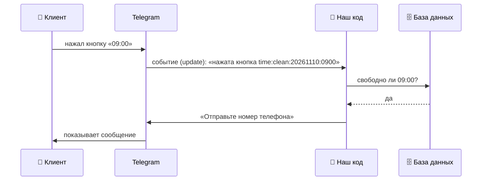
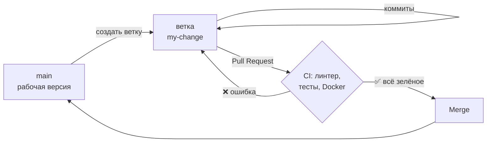

# 📚 Как устроен этот бот: разбор для тех, кто не пишет код сам

Цель этого документа: чтобы ты мог **открыть любой файл проекта и понять, что в нём происходит и зачем**, даже если сам такой код не напишешь. Этого достаточно, чтобы ставить задачи ИИ, проверять результат и объяснять заказчику, как всё работает.

Читай по порядку. В конце есть задания с ответами.

---

## 1. Большая картина

Telegram-бот — это программа, которая **ждёт событий и отвечает на них**.



Наш код **никогда не общается с клиентом напрямую**. Всё идёт через Telegram:
- Telegram присылает нам **события** (кто-то написал сообщение, нажал кнопку).
- Мы отвечаем **командами** Telegram: «отправь сообщение», «измени сообщение».

Остальное в проекте — подробности того, как именно мы решаем, что ответить.

---

## 2. Словарь: 15 слов, которые нужно знать

| Слово | Что это простыми словами | Где в проекте |
|---|---|---|
| **Update (событие)** | Посылка от Telegram: «вот что сделал пользователь» | приходит в `handlers/` |
| **Handler (обработчик)** | Функция, которая отвечает на определённый вид событий | `handlers/message.js`, `handlers/callback_query.js` |
| **Функция** | Именованный кусок кода, который что-то делает. Как рецепт: на вход продукты, на выходе блюдо | `function createBooking(...)` |
| **Inline-кнопка** | Кнопка под сообщением бота | `ui.js` |
| **callback_data** | Скрытый текст, привязанный к кнопке. Пользователь его не видит, а бот получает при нажатии | `'svc:clean'`, `'time:clean:20261110:0900'` |
| **База данных** | Хранилище, которое не забывает данные между сообщениями | SQLite |
| **Таблица** | Как лист Excel: строки — записи, столбцы — поля (имя, телефон, время) | `bookings`, `drafts` |
| **Индекс** | Правило или «оглавление» для таблицы. Уникальный индекс запрещает две одинаковые строки | `uidx_bookings_slot` |
| **import / export** | Один файл берёт функции у другого. `export` — «отдаю», `import` — «беру» | вверху каждого файла |
| **async / await** | «Подожди, пока ответит база или Telegram, потом продолжай» | почти везде |
| **Конфиг** | Файл с настройками, а не с логикой | `lib/config.js` |
| **Webhook / polling** | Два способа получать события: Telegram сам присылает (webhook) или мы спрашиваем каждые N секунд (polling) | Serverless / `standalone/bot.js` |
| **Тест** | Программа, которая проверяет программу: «нажми это, ожидай то» | `test/run.js` |
| **Линтер** | Программа, которая читает код и находит ошибки до запуска | ESLint, `npm run lint` |
| **CI** | GitHub сам запускает тесты и линтер на каждом изменении | `.github/workflows/test.yml` |

---

## 3. Карта проекта: какой файл за что отвечает

Представь бота как ресторан:

| Файл | Роль в ресторане | Что делает |
|---|---|---|
| `lib/config.js` | **Меню и вывеска** | Название, услуги, цены, часы работы. Меняется под каждого клиента |
| `handlers/message.js` | **Официант у входа** | Встречает текстовые сообщения: `/start`, номер телефона, «Отменить» |
| `handlers/callback_query.js` | **Официант в зале** | Обрабатывает нажатия кнопок |
| `lib/bookings.js` | **Администратор с журналом** | Единственный, кто пишет в базу и читает из неё: свободные слоты, записи |
| `lib/ui.js` | **Дизайнер меню** | Как выглядят сообщения и кнопки |
| `lib/time.js` | **Часы на стене** | Даты и время по Ташкенту |
| `schema.js` | **Разлиновка журнала** | Какие столбцы есть в таблицах базы |

Главное правило проекта: **официанты (handlers) не пишут в журнал сами**, они просят администратора (`bookings.js`). Так проще найти, где что происходит, и сложнее что-то сломать.

Остальные папки:
- `examples/` — готовые «меню» для разных бизнесов.
- `standalone/` — тот же ресторан, но в другом здании (на своём сервере, а не у Telegram).
- `test/` — «тайный покупатель», который проверяет каждый сценарий.

---

## 4. Путешествие одного нажатия

Клиент выбрал услугу, день и нажимает **«09:00»**. Пройдём по коду шаг за шагом.

### Шаг 1. Кнопка несёт в себе данные

Когда бот рисовал кнопки времени (`ui.js`, функция `timesScreen`), к кнопке «09:00» он привязал скрытый текст:

```
time:clean:20261110:0900
 │     │       │      └─ время 09:00
 │     │       └──────── дата 2026-11-10
 │     └──────────────── услуга «clean»
 └────────────────────── действие: выбор времени
```

Telegram ограничивает этот текст 64 байтами, поэтому дата и время записаны без дефисов и двоеточий.

### Шаг 2. Telegram вызывает обработчик кнопок

Файл `handlers/callback_query.js`:

```js
export default async function (query) {
  const userId = query.from.id;                                // кто нажал
  const chatId = query.message?.chat.id;                       // в каком чате
  const messageId = query.message?.message_id;                 // какое сообщение с кнопками
  const [action, ...args] = (query.data ?? '').split(':');    // разрезаем по «:»
```

Последняя строка — самая важная. `split(':')` режет текст по двоеточиям:
- `action` = `'time'`
- `args` = `['clean', '20261110', '0900']`

Дальше по `action` выбирается нужная функция: `if (action === 'time') ... onTime(...)`.

### Шаг 3. Проверяем, что нажатие честное

```js
async function onTime(chatId, messageId, userId, [serviceId, packedDate, packedTime]) {
  const date = unpackDate(packedDate ?? '');   // '20261110' → '2026-11-10'
  const time = unpackTime(packedTime ?? '');   // '0900' → '09:00'

  if (!findService(serviceId) || !upcomingDays().includes(date) || !(await isSlotFree(date, time))) {
    // ... показать свободное время заново
    return 'Это время уже занято, выберите другое';
  }
```

Зачем проверять, ведь кнопку нарисовал сам бот? Потому что:
- кнопка могла **устареть**: клиент открыл список час назад, а время уже кто-то занял;
- хитрый пользователь может **подделать** callback_data и отправить, например, прошедшую дату.

`||` значит «или». Если **хоть одно** из условий плохое (услуги нет, или день недоступен, или время занято), бот отказывает.

> 💡 Правило, которое стоит запомнить: **никогда не доверяй данным от пользователя**, даже если их «нарисовал» твой же бот.

### Шаг 4. Запоминаем выбор в черновике

```js
  await saveDraft(userId, serviceId, date, time);
```

Почему не создаём запись сразу? Ещё нет телефона. А бот **ничего не помнит между сообщениями**: каждый раз код запускается заново. Поэтому выбор сохраняется в таблицу `drafts` (черновики), и когда придёт телефон, бот достанет его оттуда.

### Шаг 5. Просим телефон

```js
  await api.sendMessage({
    chat_id: chatId,
    text: `Остался последний шаг: нажмите кнопку <b>«📱 Отправить номер»</b> ...`,
    parse_mode: 'HTML',               // <b>…</b> = жирный текст
    reply_markup: askContactKeyboard, // кнопка «Отправить номер» внизу экрана
  });
```

`api.sendMessage` — это команда Telegram «отправь сообщение». Все методы Telegram описаны в [документации Bot API](https://core.telegram.org/bots/api).

### Шаг 6. Кнопка не должна «висеть»

В конце обработчика кнопок стоит блок `finally`:

```js
  } finally {
    // Telegram ждёт ответа на каждое нажатие, иначе кнопка «зависает».
    await api.answerCallbackQuery({ callback_query_id: query.id, text: toast || undefined });
  }
```

`finally` выполняется **всегда**, даже если выше произошла ошибка. Без него у клиента на кнопке крутились бы «часики».

### Шаг 7. Пришёл телефон, и создаётся запись

Клиент нажимает «Отправить номер». Это уже не кнопка под сообщением, а **сообщение с контактом**, поэтому его получает `handlers/message.js`. Тот достаёт черновик и вызывает `createBooking` из `lib/bookings.js`:

```js
export async function createBooking({ userId, clientName, phone, serviceId, date, time }) {
  if (!(await isSlotFree(date, time))) return null;   // ① проверка: время всё ещё свободно?
  try {
    await db.insert(bookings)                          // ② записываем в таблицу bookings
      .values({ userId, clientName, phone, serviceId, date, time, status: 'active' })
      .run();
  } catch (e) {
    // ③ уникальный индекс сработал: кто-то записался на это же время секундой раньше
    if (!(await isSlotFree(date, time))) return null;
    throw e;
  }
  ...
}
```

Здесь **двойная защита** от двух клиентов на одно время:
1. **Проверка перед записью** ловит обычный случай.
2. **Уникальный индекс в базе** ловит редкий случай, когда два человека нажали в одну и ту же секунду и оба прошли проверку ①. База физически не даст сохранить вторую запись, и мы это обрабатываем в `catch`.

`try { ... } catch (e) { ... }` значит: «попробуй; если упало, сделай вот это».

После этого клиент получает «✅ Вы записаны!», а все админы получают уведомление (`notifyAdmins` в `ui.js`).

---

## 5. Как читать код, который не писал

1. **Начинай с имён.** Хорошие имена — половина понимания: `isSlotFree`, `createBooking`, `notifyAdmins`. Если имя непонятное, это проблема кода, а не твоя.
2. **Читай комментарии.** Строки после `//` — объяснения для человека, компьютер их пропускает.
3. **Иди от того, что видит пользователь.** Хочешь понять, откуда текст «Ждём вас!»? В VS Code нажми `Ctrl+Shift+F` и найди этот текст по всему проекту.
4. **Следуй за `import`.** Видишь `import { createBooking } from '../lib/bookings.js'`, значит функция живёт в `bookings.js`. В VS Code: `Ctrl` + клик по имени перенесёт туда.
5. **Не нужно понимать каждую строку.** Нужно понимать, **что делает блок и зачем**. Синтаксис оставь ИИ.

---

## 6. Как работать с ИИ, чтобы понимать, что он делает

**Хорошая задача** = что сделать + зачем + где + как проверить:

> «Добавь в бота команду /prices, которая показывает список услуг с ценами. Тексты бери из config.js, новый экран сделай в ui.js. Добавь сценарий в test/run.js. После изменений запусти npm run lint и npm test и объясни мне по шагам, что ты поменял.»

**После каждого изменения проверяй:**
- ✅ Тесты и линтер прошли (`npm run lint`, `npm test`, зелёная галочка на GitHub).
- ✅ ИИ может объяснить изменение простыми словами. Если не может, переспроси.
- ✅ Изменены только те файлы, которые логично было менять.

**Тревожные признаки — останови и спроси «зачем?»:**
- 🚩 Токен или пароль появился прямо в коде.
- 🚩 Удалён или ослаблен тест, «чтобы прошло».
- 🚩 Бизнес-тексты (название, услуги) появились в `handlers/` вместо `config.js`.
- 🚩 Изменение на 500 строк ради маленькой задачи.

---

## 7. Как изменения попадают в проект (git и GitHub)



- **Коммит** — сохранённый снимок изменений с описанием («добавил команду /prices»).
- **Ветка** — копия проекта для работы, чтобы не ломать основную версию (`main`).
- **Pull Request (PR)** — «предлагаю внести эти изменения». Здесь их видно построчно и проверяет CI.
- **Merge** — принять изменения в `main`.

Так работают в любой команде. Ты уже сделал это дважды.

---

## 8. Задания

Делай в VS Code или прямо на GitHub (там тоже есть поиск: клавиша `/`). Ответы спрятаны, открывай после попытки.

**Задание 1.** В каком файле и в какой строке задаётся текст «Ждём вас!»?

<details><summary>Ответ</summary>

`tgcloud/lib/config.js`, поле `TEXTS.booked`. Используется в `handlers/message.js` в функции `finishBooking`. Найти можно поиском `Ctrl+Shift+F` по тексту «Ждём».
</details>

**Задание 2.** Клиент хочет, чтобы бот работал с 9:00 до 19:00 и записывал каждые 30 минут. Что и где поменять?

<details><summary>Ответ</summary>

В `tgcloud/lib/config.js`, объект `SCHEDULE`: `open: '09:00'`, `close: '19:00'`, `slotMinutes: 30`. Код трогать не нужно. Затем `npx tgcloud push`.
</details>

**Задание 3.** Что увидит клиент, если удалить блок `finally` с `answerCallbackQuery`?

<details><summary>Ответ</summary>

Бот будет работать, но после каждого нажатия на кнопке будут крутиться «часики» загрузки: Telegram ждёт подтверждения, что нажатие обработано.
</details>

**Задание 4.** Зачем функция `esc()` в `ui.js`? Что будет, если клиент назовёт себя `<b>Ali</b>` и функции не будет?

<details><summary>Ответ</summary>

Сообщения отправляются с `parse_mode: 'HTML'`, и Telegram понимает теги вроде `<b>`. `esc()` превращает `<` и `>` в безопасные символы. Без неё имя `<b>Ali</b>` в уведомлении админу стало бы жирным, а имя вроде `<abc` вообще сломало бы отправку сообщения (Telegram ответил бы ошибкой). Это пример правила «не доверяй данным пользователя».
</details>

**Задание 5.** Почему уникальный индекс в базе нужен, если в `createBooking` уже есть проверка `isSlotFree`?

<details><summary>Ответ</summary>

Если два клиента нажмут в одну и ту же долю секунды, оба могут пройти проверку `isSlotFree` (время ещё свободно для обоих) до того, как кто-то из них сохранит запись. Индекс — последняя линия защиты: база сама не даст сохранить вторую запись на то же время.
</details>

**Задание 6 (практика).** Поменяй в `config.js` текст приветствия `TEXTS.welcome`, запусти `npm test` и убедись, что тесты прошли. Почему они не сломались, хотя текст другой?

<details><summary>Ответ</summary>

Тесты специально написаны так, чтобы не зависеть от конкретных текстов и настроек: они берут значения из `config.js`. Поэтому один и тот же набор тестов проверяет все 5 конфигураций из `examples/`.
</details>

---

Если что-то в этом документе непонятно, это повод улучшить документ. Спроси ИИ: «объясни раздел N проще» и допиши ответ сюда.
